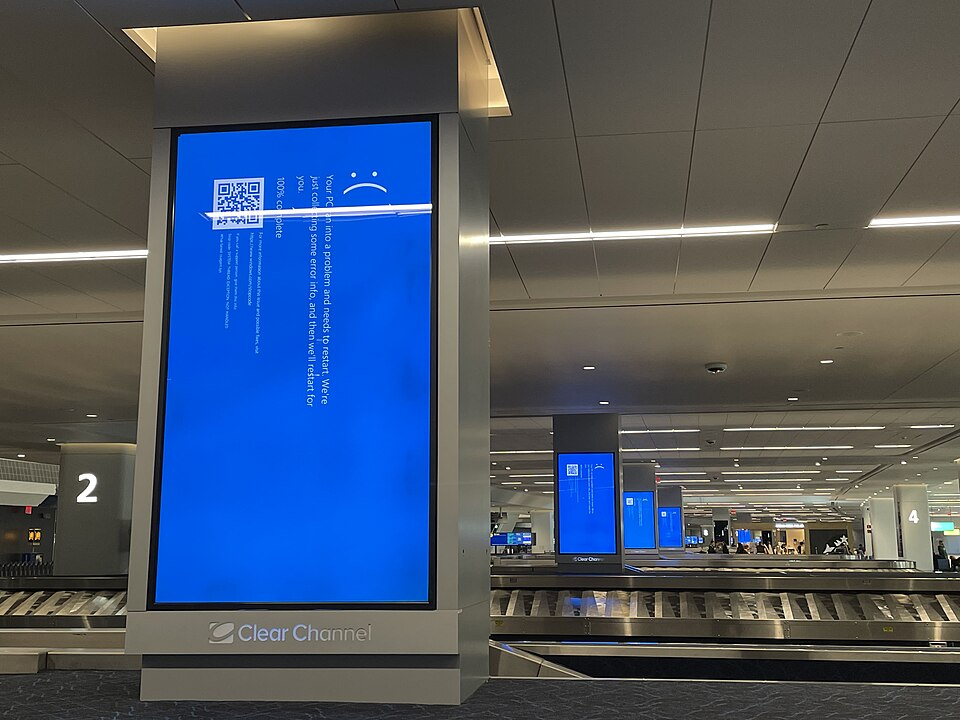
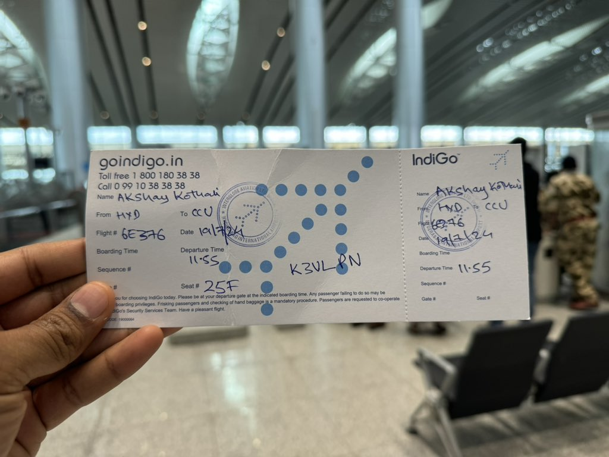
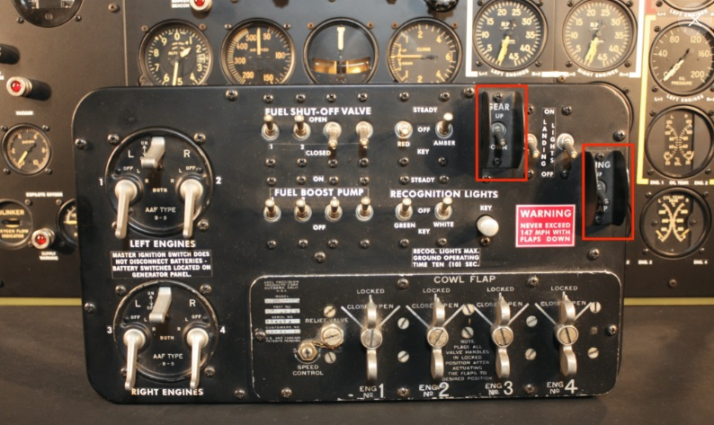
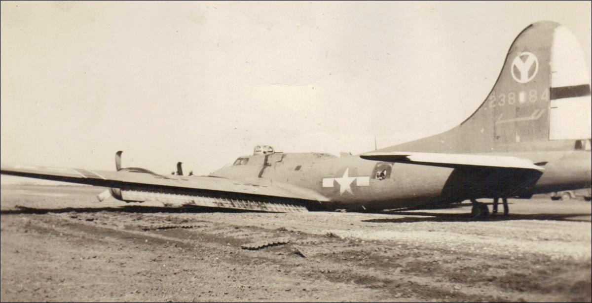
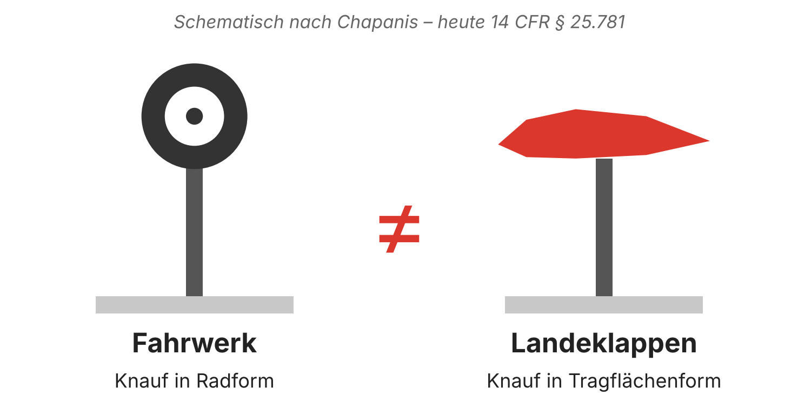
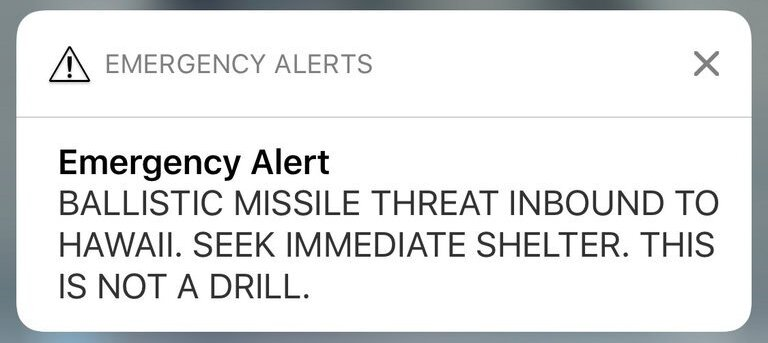
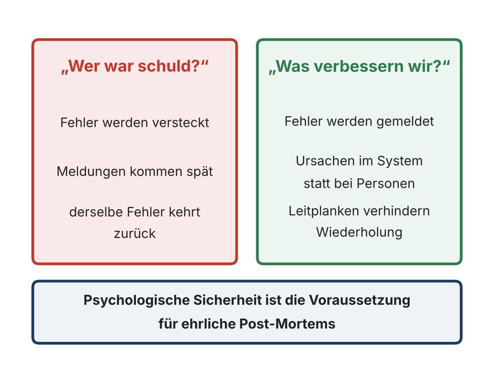
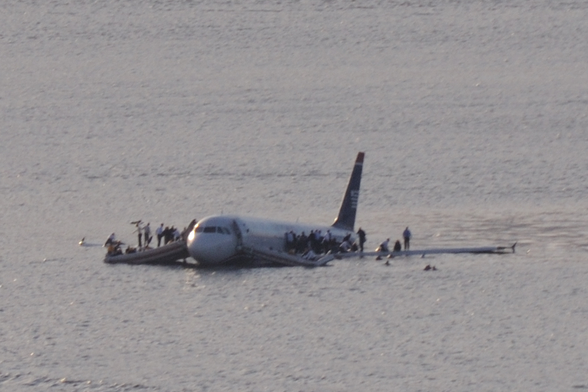
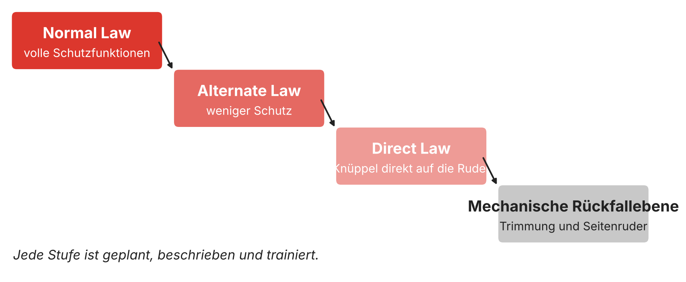

::: notes
BOARDING (vor Beginn)
- Fahrwerkpanel und Autopilot-Panel (FCU) beleuchtet auf das Pult stellen – unkommentiert.
- Powerbank vorher zu Hause ohne PC testen. Fällt das Licht aus: „Willkommen beim Thema."
- Zielzeit: 48 Minuten Vortrag, danach Diskussion bis zum Ende der Stunde.
- Falls es keine Begrüßung mit Vorstellung gibt: Flugbuch-Folie voll nutzen (2 Min.).
- Falls doch: Flugbuch auf 30 Sekunden kürzen.
Ohne Begrüßungsfloskel einsteigen, direkt mit der nächsten Folie.
:::

## 19. Juli 2024

**Die Flugzeuge waren in Ordnung.\
Ausgefallen ist alles drumherum.**

*Resilient ist, wer auch von Hand boarden kann.*

::: notes
(ca. 2 Min.) [0:00–2:00]
- Freitag, 19. Juli 2024: Ein fehlerhaftes Update der Sicherheitssoftware CrowdStrike Falcon
  legt Windows-Rechner weltweit lahm. Microsoft schätzt: rund 8,5 Millionen Geräte –
  weniger als ein Prozent aller Windows-Rechner.
- Flughäfen, Airlines, Banken, Kliniken. In Indien geben Air India, IndiGo und andere
  handgeschriebene Bordkarten aus.
- Pointe: Kein einziges Flugzeug hatte an diesem Tag ein technisches Problem.
  Ausgefallen ist alles drumherum: Check-in, Crew-Planung, Gepäck, Anzeigetafeln.
- Die kleine Zeile unten nicht vorlesen – sie wirkt allein. Wer sie liest, schmunzelt.
- NICHT sagen: einzelne Airlines (auch nicht Lufthansa) als „besonders betroffen" nennen.
:::

## Eine Frage an Sie

**Wer von Ihnen könnte morgen früh\
mit Stift und Papier weiterarbeiten?**

::: notes
(ca. 1 Min.) [2:00–3:00]
Handzeichen. „Und wer hat das schon einmal geübt?" – Hände oben lassen, Stille aushalten.
Dann: „Genau darum geht es heute. Nicht darum, dass nichts ausfällt. Sondern darum, weiterzufliegen."
:::

## Mein Flugbuch

- Physik, Promotion
- Erster CISO bei Infineon
- Selbstständig → Loomans & Matz
- Partner bei KPMG
- Professor für Wirtschaftsinformatik, Hochschule Mainz

*Und in der Freizeit: Flugsimulator, A320.*

::: notes
(ca. 2 Min.) [3:00–5:00]
Als Logbuch erzählen, nicht als Lebenslauf.
- Satz zur Selbstständigkeit: „Nach Infineon habe ich mich selbstständig gemacht.
  Später haben Manuela Matz und ich die Loomans & Matz gegründet."
  (Keine weiteren Stationen nennen. Manuela nie als „Mitgründerin" oder „Mitinhaberin".)
- Warum Luftfahrt? „Als Physiker interessieren mich Systeme, die ausfallen dürfen,
  ohne dass das Ganze abstürzt. Die Luftfahrt baut seit hundert Jahren genau solche Systeme."
- Flugsimulator: ein Satz, mit Augenzwinkern zu den Panels auf dem Pult.
:::

## Warum Fliegen so sicher ist

1. Design für Menschen
2. Automation mit Rückfallebene
3. Redundanz und geordneter Rückbau
4. Lernen statt Schuld

*… und wo der Vergleich hinkt.*

::: notes
(ca. 2 Min.) [5:00–7:00]
Diese vier Prinzipien sind die Gliederung des Vortrags.
- 1 = Akt 1 (der Hebel), 2 = Akt 2 (der Autopilot), 3 = Akt 3 (wenn alles ausfällt).
- 4 = Lernen statt Schuld zieht sich durch: Unfalluntersuchungen in der Luftfahrt
  dienen ausdrücklich nicht der Schuldzuweisung (BEA, NTSB).
- Ankündigen: „Und weil der Titel ‚und was nicht' verspricht: Am Ende sage ich Ihnen,
  wo der Vergleich hinkt. Gerade für die Gäste aus der Luftfahrt."
:::

## Akt 1 · Der Hebel {.section}

::: notes
(Übergang, 10 Sekunden) Fahrwerkpanel in die Hand nehmen.
:::

## Zweiter Weltkrieg, Boeing B-17

**Zwei gleiche Schalter, nebeneinander.**

*Nach der Landung, beim Ausrollen, griffen müde Piloten zum falschen.*

::: notes
(ca. 1,5 Min.) [7:00–8:30]
Panel in die erste Reihe geben: „Woran erkennen Sie blind, dass das das Fahrwerk ist?"
- Links: das Bedienpanel der B-17. Rot markiert: GEAR und WING FLAP – zwei gleiche Kippschalter.
- B-17 im Zweiten Weltkrieg: Nach der Landung, beim Ausrollen, fahren erschöpfte Piloten
  das Fahrwerk ein statt der Landeklappen.
- Rechts: eine B-17 auf dem Bauch. NICHT behaupten, dass genau dieses Flugzeug
  wegen einer Schalterverwechslung so liegt – das Foto zeigt nur, wie so etwas endet.
- Damals hieß das: Pilotenfehler.
:::

## Die Antwort war Form

**Aus „Pilotenfehler“\
wurde „Konstruktionsfehler“.**

::: notes
(ca. 1,5 Min.) [8:30–10:00]
- Der Psychologe Alphonse Chapanis erkennt: kein Pilotenfehler, sondern ein Konstruktionsfehler.
- Lösung: kein Training, keine Strafe – Form. Ein kleines Rad am Fahrwerkshebel,
  ein Keil am Klappenhebel.
- Heute vorgeschrieben in den Zulassungsvorschriften für Verkehrsflugzeuge (14 CFR 25.781).
  „Was Sie in der Hand halten, ist der Fahrwerkshebel eines A320. Dasselbe Rad."
- NICHT sagen: „400 Abstürze" oder „Fahrwerk vor der Landung nicht ausgefahren" – nicht belegt bzw. falsch.
:::

## Hawaii, 13. Januar 2018

**Übung und Ernstfall:\
zwei Einträge im selben Menü.**

::: notes
(ca. 2,5 Min.) [10:00–12:30]
- Morgens geht an alle Handys in Hawaii: Raketenangriff, das ist keine Übung.
  38 Minuten bis zur Entwarnung.
- Im Menü standen „PACOM (CDW) - STATE ONLY" und „DRILL - PACOM (CDW) - STATE ONLY" fast gleich untereinander.
- Wichtig, fair bleiben:
  - Das Bild ist eine Nachbildung der Behörde („close facsimile"), kein echter Screenshot.
  - Laut FCC war es kein Fehlklick: Der Mitarbeiter hielt die Übung für echt,
    wählte bewusst den Ernstfall und bestätigte die Rückfrage „Are you sure…?" mit Ja.
- Pointe: Die Sicherheitsabfrage hat nichts verhindert. Sie hat nur bestätigt, was er glaubte.
- Lösung danach: Übung und Ernstfall sollten sich deutlich unterscheiden – Formcodierung, wie bei der B-17.
:::

## Citibank, August 2020

**7,8 Millionen Dollar sollten raus.\
Fast 900 Millionen gingen raus.**

*Drei Personen haben geprüft.*

::: notes
(ca. 2,5 Min.) [12:30–15:00]
- Citi sollte für Revlon Zinsen von rund 7,8 Mio. USD an Gläubiger überweisen.
- In der Software Flexcube führte der Weg über eine unintuitive Kombination von Feldern und Häkchen.
  Am Ende ging die gesamte Restschuld raus: rund 893 Mio. USD.
- Drei Personen haben den Vorgang geprüft. „Vier-Augen-Prinzip – hier sogar sechs Augen."
- Juristischer Nachgang: Richter Furman ließ die Gläubiger das Geld zunächst behalten,
  2022 hob das Berufungsgericht (2nd Circuit) das auf und gab Citi recht.
- Brücke: „Die B-17 ist 80 Jahre her. Die Software-Welt baut die gleichen Schalter immer noch."
:::

## These A {.center}

> Nicht der Mensch ist die Schwachstelle,
> sondern der Hebel, der aussieht wie der andere.

::: {.fragment}
> Eine Sicherheitsabfrage ist kein Rad am Hebel.
:::

::: notes
(ca. 1 Min.) [15:00–16:00]
Erst die These stehen lassen, dann klicken für den zweiten Satz.
„Wo ist das Rad am Hebel in Ihrer IT?" – Frage offen lassen, nicht beantworten.
Panel zurückholen.
:::

## Wer war schuld?

**Die IT fragt: Wer hat geklickt?\
Die Luftfahrt fragt: Was hat ihn klicken lassen?**

*Hawaii: Der Mitarbeiter wurde entlassen. Die Ursachen lagen im Ablauf.*

::: notes
(ca. 2 Min.) – Zeit an anderer Stelle einsparen
- IT-Reflex: Phishing-Klicker an den Pranger, „Layer 8", „das Problem sitzt vor dem Bildschirm".
  Folge: Fehler werden versteckt, Meldungen kommen spät, derselbe Fehler kehrt zurück.
- Luftfahrt: Unfalluntersuchungen dienen nach ICAO Annex 13 nicht der Schuldzuweisung.
  NASA-Meldesystem ASRS seit 1976: vertraulich melden, dafür begrenzter Schutz vor Sanktionen.
  EU-VO 376/2014: „Just Culture" ist Gesetz.
- Wichtig: Just Culture heißt nicht „keine Konsequenzen". Vorsatz und grobe Fahrlässigkeit bleiben
  ausgenommen. Es geht um ehrliche Fehler.
- Hawaii: Der Mitarbeiter wurde entlassen, der Behördenleiter trat zurück. Der stellvertretende
  Leiter sagte beim Rücktritt sinngemäß, man habe den Mitarbeiter in eine Lage gebracht, in der er
  scheitern musste. Ursachen laut FCC: unangekündigte Übung beim Schichtwechsel, missverständliche
  Ansage, keine vorbereitete Widerrufsmeldung (38 Minuten).
  NICHT behaupten, die Entlassung sei nur ein Sündenbock gewesen – der Mann hatte laut interner
  Untersuchung eine lange Vorgeschichte.
- Gegenbeispiel aus der IT: Cloudflare 2019, öffentliches Post-Mortem ohne Namen.
- Rückbezug Lehre: Genau das üben wir in der Einführung zur Cyber-Resilienz – Blame-free Post-Mortems,
  psychologische Sicherheit (Edmondson).
:::

## Akt 2 · Der Autopilot {.section}

::: notes
(Übergang, 10 Sekunden) FCU-Panel zeigen: „Jeder Knopf hat eine andere Form. Aus demselben Grund."
:::

## Children of the Magenta

**American Airlines, 1997:\
„Wir sind Piloten, keine Automationsmanager.“**

*Die magentafarbene Linie: der Kurs, den der Bordcomputer vorgibt.*

::: notes
(ca. 2 Min.) [16:00–18:00]
- 1997 hält Kapitän Warren Vanderburgh bei American Airlines eine Schulung gegen die
  Abhängigkeit von der Automation. Titel wird zum geflügelten Wort: „Children of the Magenta".
- Kern: Die richtige Automationsstufe wählen – und herunterschalten können,
  wenn man sich fragt „Was macht er denn jetzt?"
- Das Zitat auf der Folie ist sinngemäß aus dem Vortrag (so in vielen Quellen wiedergegeben).
- NICHT sagen: „68 % der Unfälle" – diese Zahl nur aus Zweitquellen, nicht belegt.
:::

## Air France 447, 1. Juni 2009

:::: {.columns}
::: {.column width="50%"}
**Was passierte**

- Pitotsonden vereisen
- Der Autopilot schaltet ab
- Die Crew verliert den Überblick
- 228 Menschen sterben
:::
::: {.column width="50%"}
**Was die BEA sagt**

- Die Crew war nicht vorbereitet
- Die meisten Crews wären es nicht gewesen
- 25 Empfehlungen: Training, Anzeigen, Systeme
:::
::::

::: notes
(ca. 2,5 Min.) [18:00–20:30]
- Nacht über dem Atlantik, Rio–Paris, A330. Eiskristalle verstopfen die Pitotsonden,
  die Geschwindigkeitsanzeigen widersprechen sich. Der Autopilot schaltet ab – so ist er gebaut.
- Das Flugzeug wechselt von Normal Law in Alternate Law. Die Crew reagiert falsch,
  das Flugzeug geht in einen Strömungsabriss und stürzt ins Meer. Alle 228 Menschen sterben.
- Die BEA betont: wahrscheinlich hätte eine andere Crew genauso gehandelt.
  Nicht die Crew allein, sondern Training und Systeme.
- Brücke: Jahrelang hat die Automation alles gemacht. Als sie ging, war das Können weg.
:::

## Der Patch, der zwei Tage zu spät kam

**Schwachstelle bekannt. Lösung verfügbar.\
Nicht verpflichtend.**

*Austausch der Sonden begann am 30. Mai 2009. Absturz am 1. Juni.*

::: notes
(ca. 1,5 Min.) [20:30–22:00]
- Airbus und Air France kannten die Schwäche der Sonden und hatten mit dem Austausch begonnen –
  am 30. Mai 2009, zwei Tage vor dem Absturz. Dieses Flugzeug war noch nicht dran.
- Die EASA hatte die Vereisungsfälle untersucht und den Tausch nicht verpflichtend gemacht.
- Pause. Dann: „Kommt Ihnen das aus dem Patch-Management bekannt vor?"
- Vorsicht: Nicht behaupten, neue Sonden hätten den Absturz sicher verhindert.
  Die BEA nennt mehrere Faktoren.
:::

## Und Ihre Organisation?

**Wer fliegt von Hand,\
wenn der KI-Agent abschaltet?**

- Welche Rechte hat der Agent – und wer hat sie vergeben?
- Wer merkt, dass er falsch fliegt?
- Wann wurde der Handbetrieb zuletzt geübt?

::: notes
(ca. 2 Min.) [22:00–24:00]
- Übertragung: KI-Agenten im SOC, in der Kundenbetreuung, in der Rechtevergabe.
  Sie übernehmen Routine – und mit der Routine verschwindet das Können.
- Identitäten von Agenten: Wer vergibt Berechtigungen an Maschinen, wer überprüft sie?
  (Anknüpfung an den SailPoint-/KPMG-Impuls, für die Gäste aus dem Identity-Umfeld.)
- Erste Frage: Wer würde es merken? Bei AF447 hat niemand das Verfahren „Unreliable Speed" ausgerufen.
:::

## These B {.center}

> Wer nicht mehr von Hand fliegen kann,
> darf den Autopiloten nicht einschalten.

::: notes
(ca. 0,5 Min.) [24:00–24:30]
Kurz stehen lassen. „Das gilt für Organisationen. Und es gilt für KI."
:::

## Akt 3 · Wenn alles ausfällt {.section}

::: notes
(Übergang, 10 Sekunden)
:::

## Hudson River, 15. Januar 2009

**208 Sekunden.\
Die Checkliste war für große Höhe geschrieben.**

*Im Notfall fällt man nicht auf das Niveau der Dokumentation zurück, sondern auf das Niveau der Übung.*

::: notes
(ca. 3 Min.) [24:30–27:30]
- A320 startet in LaGuardia, Vogelschlag, beide Triebwerke verlieren fast den gesamten Schub.
- Vom Vogelschlag bis zur Wasserung: rund 208 Sekunden. Alle 155 Menschen überleben.
- Sullenberger übernimmt, Skiles arbeitet die Checkliste für den Doppelausfall ab.
  Die war für einen Ausfall in großer Höhe gedacht – mit viel mehr Zeit.
- Sullenberger startet die APU sofort, viel früher als in der Checkliste vorgesehen.
- Das NTSB empfahl danach u. a. Checklisten für den Doppelausfall in geringer Höhe.
- Lehre: Der Plan war für den falschen Fall geschrieben. Geholfen haben Training und Urteilskraft.
  Satz auf der Folie langsam vorlesen: „Im Notfall fällt man nicht auf das Niveau der Dokumentation
  zurück, sondern auf das Niveau der Übung."
- Herkunft: eigene Zuspitzung, frei nach dem Militärspruch „You don't rise to the level of your
  expectations, you fall to the level of your training". NICHT Archilochos zuschreiben – dafür gibt es keinen Beleg.
  „Ihr Notfallhandbuch ist auch für einen bestimmten Fall geschrieben. Für welchen?"
:::

## Geordneter Rückbau

**Der A320 fällt nicht aus.\
Er fällt zurück.**

::: notes
(ca. 2,5 Min.) [27:30–30:00]
- Fly-by-Wire: fünf Flugsteuerungsrechner, 2 ELAC und 3 SEC.
  Unterschiedliche Hardware, unterschiedliche Software – damit nicht ein Fehler alle trifft.
- Fallen Rechner oder Sensoren aus, schaltet das System stufenweise zurück:
  Normal Law (volle Schutzfunktionen) → Alternate Law (weniger Schutz) → Direct Law
  (Steuerknüppel direkt auf die Ruder) → mechanische Rückfallebene (Trimmung und Seitenruder).
- Jede Stufe ist geplant, beschrieben und trainiert.
- Frage: „Wie sieht der Direct Law Ihres ERP aus? Und wer hat ihn geübt?"
- Für die Lufthansa-Gäste: präzise bleiben, nicht vereinfachen, was nicht stimmt.
:::

## 19. Juli 2024 – noch einmal

:::: {.columns}
::: {.column width="50%"}
**A320**

- Fünf Rechner
- Zwei Bauarten
- Unterschiedliche Software
:::
::: {.column width="50%"}
**Ihre IT**

- Ein Sicherheitsagent
- Ein Update
- Alle Rechner gleichzeitig
:::
::::

::: notes
(ca. 2 Min.) [30:00–32:00]
- Zurück zum Prolog: 8,5 Millionen Rechner, ein einziges fehlerhaftes Update.
- In der Luftfahrt baut man gezielt unterschiedliche Systeme, damit derselbe Fehler nicht alle trifft.
- In der IT kopieren wir dasselbe System tausendfach und nennen es Ausfallsicherheit.
- Brücke zur digitalen Souveränität (Vortrag Wiesbaden): Monokultur ist nicht nur ein technisches Risiko,
  sondern eine Frage der Entscheidungsfähigkeit.
:::

## Maersk, Juni 2017

**Alle 150 Domain Controller zerstört.\
Gerettet hat ein Stromausfall in Ghana.**

*Das war kein Notfallplan. Das war Glück.*

::: notes
(ca. 2 Min.) [32:00–34:00]
- NotPetya, Juni 2017: Die Schadsoftware zerstört bei Maersk alle Domain Controller weltweit.
  Ohne Active Directory kann niemand sich anmelden – nichts lässt sich wiederherstellen.
- Ein einziger Domain Controller in Ghana hat überlebt – weil dort kurz vorher der Strom ausgefallen war
  und er offline war.
- Die Daten werden per Staffellauf (Ghana → Nigeria → England) ins Wiederherstellungszentrum gebracht. Danach Wiederaufbau in rund zehn Tagen.
- Quelle: Andy Greenberg, WIRED 2018. Schadenszahlen nur nennen, wenn gefragt (Größenordnung 300 Mio. USD).
:::

## These D {.center}

> Hundert Kopien desselben Systems
> sind keine Redundanz, sondern ein Klumpenrisiko.

::: notes
(ca. 0,5 Min.) [34:00–34:30]
„Redundanz heißt: verschieden. Nicht: viel."
:::

## Akt 4 · Wo der Vergleich hinkt {.section}

::: notes
(Übergang, 10 Sekunden) „Jetzt der ehrliche Teil."
:::

## Vier Unterschiede

1. Das Gewitter lernt nicht mit.
2. Eine Zulassung dauert Jahre, ein Exploit Stunden.
3. Redundanz rechnet mit Zufall – ein Angreifer nicht.
4. Auch die Luftfahrt vergisst ihre Regeln.

::: notes
(ca. 3 Min.) [34:30–37:30]
1. Wetter und Vogelschlag passen sich nicht an. Angreifer lesen unsere Checklisten mit
   – eine veröffentlichte Notfallprozedur ist auch eine Angriffsanleitung.
2. Zertifizierung friert Software ein. Sicherheit verlangt Updates. Beispiel Medizingeräte (Lux-Vortrag):
   „Wir dürfen nicht patchen, sonst erlischt die Zulassung" – so pauschal stimmt das nicht, aber das Spannungsfeld ist real.
3. Zwei Triebwerke fallen selten unabhängig gleichzeitig aus – der Hudson war die Ausnahme.
   Ein Angreifer greift alle Kopien gleichzeitig an – das ist die Regel.
4. → nächste Folie.
:::

## Boeing 737 MAX

**Ein einziger Sensor.\
Eine weitgehend delegierte Prüfung.\
Zu wenig Einblick der Aufsicht.**

*Joint Authorities Technical Review, Oktober 2019*

::: notes
(ca. 2 Min.) [37:30–39:30]
- Zwei Abstürze (Lion Air 2018, Ethiopian 2019), 346 Tote.
- Das MCAS hing an einem einzigen Anstellwinkelsensor.
- Der JATR-Bericht: Die FAA hatte große Teile der Zulassung an Boeing delegiert und hatte zu wenig
  Einblick in das MCAS, um es unabhängig zu bewerten.
- Fair bleiben: Der Bericht sagt auch, dass Delegation an sich die Sicherheit nicht gefährdet –
  wenn die Aufsicht ausreichend beteiligt ist.
- Pointe: „Die Luftfahrt hat ihre eigenen Prinzipien vergessen – Single Point of Failure."
:::

## Die Luftfahrt lernt jetzt auch von uns

**Part-IS: Seit dem 22. Februar 2026\
brauchen Airlines, Instandhaltung und Flugsicherung\
ein Managementsystem für Informationssicherheit.**

*Der Lernpfad läuft in beide Richtungen.*

::: notes
(ca. 1,5 Min.) [39:30–41:00]
- EU-Verordnungen 2022/1645 und 2023/203 („Part-IS"). Für Hersteller- und Flughafenorganisationen
  seit 16. Oktober 2025, für Luftfahrtunternehmen, Part-145, CAMO, Flugsicherung, Ausbildung
  seit 22. Februar 2026.
- Nach EASA-Leitlinien gibt es eine Übergangszeit, bis das ISMS voll wirksam sein muss.
- Blick zu den Lufthansa-Gästen, aber KEINE Interna, keine Bewertung von Lufthansa.
  Ggf.: „Einige von Ihnen wissen darüber mehr als ich."
:::

## These E {.center}

> Die Luftfahrt kämpft gegen das Wetter.
> Wir kämpfen gegen jemanden, der mitliest.

::: notes
(ca. 0,5 Min.) [41:00–41:30]
Stehen lassen. Dann zum Schluss überleiten.
:::

## Akt 5 · Landung {.section}

::: notes
(Übergang, 10 Sekunden)
:::

## Der Cyber Resilience Act

:::: {.columns}
::: {.column width="50%"}
**Luftfahrt**

- Musterzulassung unter behördlicher Aufsicht
- Lufttüchtigkeit über den ganzen Lebenszyklus
- Meldepflicht für Vorfälle
:::
::: {.column width="50%"}
**Digitale Produkte (CRA)**

- CE-Kennzeichnung ab 11.12.2027
- Pflichten über den ganzen Lebenszyklus
- Meldepflicht seit 11.09.2026
- Meist Selbstbewertung durch den Hersteller
:::
::::

::: notes
(ca. 2,5 Min.) [41:30–44:00]
- Verordnung (EU) 2024/2847. Zum ersten Mal Pflichten über den ganzen Lebenszyklus von Produkten
  mit digitalen Elementen: Sicherheit ab Entwurf, Updates, Schwachstellenmanagement, SBOM.
- Seit 11. September 2026: Hersteller melden aktiv ausgenutzte Schwachstellen und schwere Vorfälle
  (Frühwarnung binnen 24 Stunden).
- Ab 11. Dezember 2027 gelten die übrigen Pflichten, CE-Kennzeichnung.
- Für die große Mehrheit der Produkte genügt eine Selbstbewertung des Herstellers (Modul A).
  Wichtige und kritische Produkte: harmonisierte Normen bzw. benannte Stelle bzw. Zertifizierung.
- „Rund 90 Prozent" NICHT als Fakt auf die Folie – Branchenschätzung. Mündlich höchstens „die große Mehrheit".
- KEIN Werbeblock für Loomans & Matz. Die Prüfstelle ist Thema für das Gespräch danach.
:::

## Eine Bemerkung zum Schluss {.center}

> Auch die Luftfahrt delegiert Prüfungen.
> Entscheidend ist die Aufsicht.

::: notes
(ca. 0,5 Min.) [44:00–44:30]
Bewusst als Bemerkung, nicht als These. Brücke von der 737 MAX zum CRA:
Selbstbewertung funktioniert – wenn jemand hinschaut. Ton: nüchtern, nicht anklagend.
:::

## Was ich an der Hochschule Mainz vorhabe

- **Lehre:** Resilienz üben, nicht nur lernen
- **Forschung:** Prüfkriterien für den Cyber Resilience Act
- **Transfer:** Abschlussarbeiten mit Unternehmen und Prüfpraxis
- **Einladung:** Fallstudien und Übungen – gemeinsam mit Ihnen

::: notes
(ca. 2 Min.) [44:30–46:30]
- Lehre im Cyber Security Management: Tabletop-Übungen, Notfallbetrieb, Fallstudien wie heute.
- Forschung: Prüfkatalog/Prüfstandards für den CRA, gemeinsam mit Kollegen der Hochschule
  (Nicolai Kuntze nur namentlich nennen, wenn mit ihm abgestimmt).
- Transfer: Abschlussarbeiten mit Unternehmen – hier dürfen sich Lufthansa, Mainz 05
  und die Gäste aus dem Freundeskreis angesprochen fühlen, ohne Namen zu nennen.
- Einladung an alle: „Bringen Sie mir Ihre Fälle."
:::

## Debriefing

1. Nicht der Mensch ist die Schwachstelle, sondern der Hebel, der aussieht wie der andere.
2. Wer nicht mehr von Hand fliegen kann, darf den Autopiloten nicht einschalten.
3. Hundert Kopien desselben Systems sind keine Redundanz, sondern ein Klumpenrisiko.
4. Die Luftfahrt kämpft gegen das Wetter. Wir kämpfen gegen jemanden, der mitliest.

**Resilienz heißt: weiterfliegen.**

::: notes
(ca. 1,5 Min.) [46:30–48:00]
Thesen nicht vorlesen, nur je einen Halbsatz dazu. Dann Schlusssatz, Pause.
„Ich freue mich auf Ihre Fragen – und auf Ihren Widerspruch."
Mögliche Frage für die Diskussion, falls es stockt:
„Wer haftet, wenn der Autopilot eine KI ist?"
Panels bleiben für das Gespräch danach stehen.
:::

## Quellen {.klein}

:::: {.columns}
::: {.column width="50%"}
**Fälle**

- CrowdStrike 19.07.2024: Microsoft (D. Weston), 20.07.2024
- Chapanis/B-17: UX Magazine; 14 CFR § 25.781
- Hawaii 2018: FCC-Untersuchungsbericht; Civil Beat, 30.01.2018
- Citibank/Revlon: SDNY 2021; 2nd Circuit 2022
- AF447: BEA, Final Report (Juli 2012)
- US Airways 1549: NTSB/AAR-10/03
- Maersk/NotPetya: A. Greenberg, WIRED (2018)
- 737 MAX: Joint Authorities Technical Review (2019)
:::
::: {.column width="50%"}
**Regeln und Technik**

- A320-Flugsteuerung: Traverse/Lacaze/Souyris, Airbus Fly-by-Wire
- Part-IS: VO (EU) 2022/1645 und 2023/203
- Cyber Resilience Act: VO (EU) 2024/2847
- Just Culture: ICAO Annex 13; NASA ASRS; VO (EU) 376/2014

**Bildnachweise**

- LaGuardia: Smishra1, Wikimedia Commons, CC BY-SA
- Bordkarte: Akshay Kothari (@akothari), X, 19.07.2024
- Flexcube: Gerichtsakte SDNY 2021, via Core77
- Hudson: Greg L, Wikimedia Commons, CC BY 2.0
- B-17-Panel und Bauchlandung: QUELLE ERGÄNZEN
- Schaubilder: eigene Darstellung
:::
::::

::: notes
Nur für die PDF-Fassung, nicht im Vortrag zeigen.
:::
